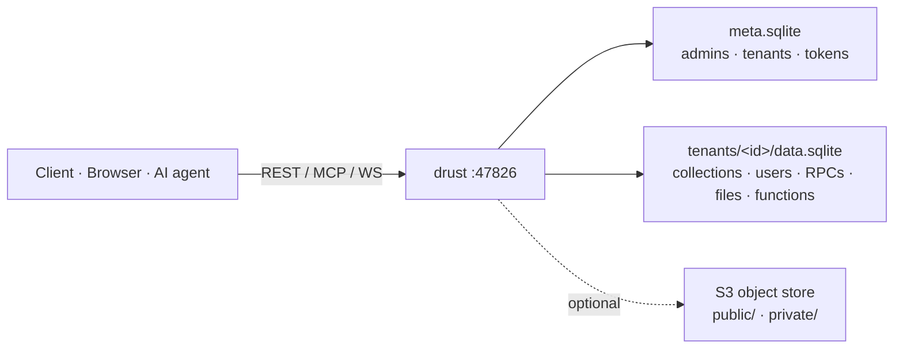

<div align="center">


<br/>

**The backend your AI agents can drive — and your users can trust.**
A self-hosted, multi-tenant SQLite Backend-as-a-Service in one Rust binary:
per-tenant REST **and** a native MCP endpoint, row-level security, realtime,
vector search, and WebAssembly edge functions. One file per tenant. No database server.

[](https://www.rust-lang.org)
[](https://modelcontextprotocol.io)
[](https://www.sqlite.org)
[](#zap-quickstart)
[](CHANGELOG.md)
[](LICENSE)

[**Quickstart**](#zap-quickstart) · [**What you can build**](#rocket-what-you-can-build) · [**Why drust**](#bulb-why-drust) · [**Docs**](docs/architecture.md) · [繁體中文](README.zh.md)

</div>

---

## :sparkles: In one sentence

Spinning up a Postgres or Supabase per project is overkill for the hundreds of small apps, internal tools, and AI-agent scratchpads a team accumulates. **drust** gives each project a self-contained `tenant.sqlite`, a typed API that never accepts raw SQL on the write path, row-level security, and a per-tenant MCP server an AI agent can drive with **zero glue code** — all from a single binary that idles at ~15 MB and serves ~13k req/s.

## :rocket: What you can build

| | |
|---|---|
| :bricks: **A SaaS / CRUD backend** | Define collections in the admin UI, get REST + typed TypeScript/Zod clients instantly. No DB server, no migration tooling. |
| :robot: **An AI-agent-native datastore** | Point any MCP client at `/t/<id>/mcp` — the agent inspects the schema, does CRUD, runs vector search, manages files through typed tools. Errors carry a `suggested_fix`; three destructive ops (`delete_record`, `drop_collection`, `drop_index`) support `dry_run`. |
| :office: **A multi-tenant platform** | One process, many fully-isolated tenants. Cross-tenant access is denied **in-SQL** by the authorizer, not just in app code. |
| :lock: **Per-user secured data** | Declare an `owner_field`, or write PocketBase-style row-level policies — every **record** read, write, and realtime event is filtered for you. Uploaded files have their own gate of the same shape: per-verb caps plus per-prefix policies over the file's logical path. |
| :zap: **Realtime apps** | Subscribe over SSE, or multiplex many rooms over one WebSocket and broadcast JSON. |
| :brain: **Semantic search** | Add a `vector` field, query cosine / L2 / L1 top-k over a structured filter. |
| :mag: **Full-text search** | Create a trigram (CJK-friendly, the default) or `unicode61` FTS5 index over TEXT fields, then add `{"$fts":{"index":"…","query":"…"}}` to any `/list` / `/search` / `/aggregate` filter — matches are owner-/RLS-scoped like every other read. |
| :hook: **Event-driven automation** | Upload a small WebAssembly edge function that runs in-process on record changes or file uploads. |

## :bulb: Why drust

- **:robot: AI-native, not bolted-on.** Every tenant ships a Streamable-HTTP MCP server whose `instructions` prologue is a structured *intent → tool* map, so an agent is productive on first connect — no prompt engineering, no custom tool wrappers.
- **:ice_cube: One binary, one file per tenant.** SQLite embedded, no database server to run or back up separately. Cross-tenant `ATTACH` is impossible — enforced by SQLite's authorizer on read-only connections.
- **:closed_lock_with_key: Security that composes.** `owner_field` + per-operation RLS policies (structured Filter AST → `?`-bound SQL) AND-compose on every record read/write/realtime surface; files AND-compose the same way, a per-verb cap outside and a per-prefix policy inside. The write path **never** accepts raw SQL. An object published to the public bucket is the deliberate exception — it is served straight from the object store, so publishing is a per-prefix grant, not a per-request check.
- **:feather: Fast and dense.** ~15 MB idle, ~13k req/s on a laptop, dozens of tenants on a 256 MB box. Built in Rust on [axum](https://github.com/tokio-rs/axum) + [`rmcp`](https://github.com/modelcontextprotocol/rust-sdk).
- **:battery: Batteries included.** Realtime (SSE + WS rooms), vector search, wasm edge functions, stored RPCs, per-tenant OAuth, outbound webhooks (SSRF-guarded), S3 file storage with resumable uploads, typed-client codegen (OpenAPI / TS / Zod), Prometheus metrics, daily backups, and a Supabase-style admin UI.
- **:computer: A gh-style CLI.** The `drust` command-line tool logs in via a browser **device flow** (`drust auth login` — no pasted token) and drives the host admin-plane (`drust admin tenants|keys|team|audit|backups`) plus per-tenant CRUD, all over the same HTTP surface. Prebuilt binaries ship per release for Linux (x86_64 / aarch64), macOS (Apple Silicon), and Windows.

## :bar_chart: How it compares

| | **drust** | PocketBase | Supabase | Firebase |
|---|:---:|:---:|:---:|:---:|
| **License / open source** | AGPL-3.0 | MIT | Apache-2.0 | proprietary |
| Self-hosted, single binary | :white_check_mark: | :white_check_mark: | :warning: heavy stack | :x: cloud only |
| Per-tenant DB isolation | :white_check_mark: one SQLite/tenant | :x: one DB | :x: one Postgres | :warning: |
| **Native MCP endpoint for AI agents** | :white_check_mark: | :x: | :x: | :x: |
| Row-level security | :white_check_mark: owner + policies | :white_check_mark: rules | :white_check_mark: Postgres RLS | :white_check_mark: rules |
| Realtime | :white_check_mark: SSE + WS rooms | :white_check_mark: | :white_check_mark: | :white_check_mark: |
| Edge functions | :white_check_mark: wasm, in-process | :warning: JS hooks | :white_check_mark: Deno, separate | :white_check_mark: separate |
| Vector search | :white_check_mark: sqlite-vec | :x: | :white_check_mark: pgvector | :warning: |
| Typed-client codegen | :white_check_mark: OpenAPI/TS/Zod | :warning: | :white_check_mark: | :warning: |
| Idle footprint | ~15 MB | small | large | n/a |
| Language | Rust | Go | TS / Elixir | proprietary |

## :zap: Quickstart

drust serves plain HTTP — front it with a TLS-terminating reverse proxy (Caddy, nginx, Traefik) in production.

**Run the prebuilt image** — multi-arch (amd64 / arm64), no clone, no build:

```bash
docker run -d --name drust -p 47826:47826 -v drust-data:/data \
  -e DRUST_INIT_ADMIN_USERNAME=admin -e DRUST_INIT_ADMIN_PASSWORD=changeme \
  ghcr.io/kaellim/drust

curl -s http://localhost:47826/health   # → ok
open http://localhost:47826/login       # admin UI (root mode); log in with the DRUST_INIT_ADMIN_* above
```

**Or build from the repo** — adds the bundled Caddy and optional S3 storage:

```bash
git clone https://github.com/KaelLim/drust.git && cd drust

docker compose up -d                 # drust on http://localhost:47826 (no file storage)
# ...or with S3 file storage (drust + RustFS), once:
deploy/compose-storage-env.sh        # writes .env: COMPOSE_FILE + generated keys
docker compose up -d
```

```bash
curl -s http://localhost:47826/health        # → ok
open http://localhost/login                  # admin UI via the bundled Caddy (root mode); log in with DRUST_INIT_ADMIN_*
```

> [!CAUTION]
> Don't run the container under a seccomp/AppArmor profile that blocks `mmap(PROT_EXEC)` — wasmtime's JIT (used by edge functions) needs executable memory. Docker's default profile is fine; the guest sandbox is enforced *inside* wasmtime, not by process-wide W^X.

<details>
<summary><b>Build from source instead</b></summary>

```bash
git clone https://github.com/KaelLim/drust.git && cd drust
cp .env.example .env             # edit DRUST_INIT_ADMIN_* and friends
cargo build --release
./target/release/drust            # binds 127.0.0.1:47826 by default
curl -s http://127.0.0.1:47826/health   # → ok
```
For systemd deployment behind a reverse proxy, see [`CLAUDE.md`](CLAUDE.md) and the `deploy/` unit templates.

</details>

## :building_construction: Architecture



Three request surfaces — admin UI (cookie session), tenant REST (`anon` / `user` / `service` bearer), and tenant MCP (`service` only). Public object reads bypass drust entirely; drust only sits in the *write* path. The full per-file source index lives in [`docs/architecture.md`](docs/architecture.md).

<details>
<summary><b>API surfaces</b></summary>

| Surface | Path | Auth | Use |
|---|---|---|---|
| Admin UI | `/admin/*` | Cookie session | Tenant + schema management, policies, files, functions |
| Tenant REST | `/t/<id>/...` | Bearer (`anon` / `user` / `service`) | CRUD, `/list`, `/search`, RPC, files, uploads, realtime |
| Tenant MCP | `/t/<id>/mcp` | Bearer (`service` only) | LLM tool calls — CRUD, schema, indexes, RPCs, files, vector search, webhooks, policies, functions |
| Codegen | `/t/<id>/{openapi.json,types.ts,zod.ts}` | Bearer | Typed clients for the tenant's current schema |
| Health | `/health` | none | Liveness probe |

</details>

<details>
<summary><b>Configuration (environment variables)</b></summary>

| Variable | Required | Purpose |
|---|---|---|
| `DRUST_DATA_DIR` | yes | Base dir for `meta.sqlite`, `meta_logs.sqlite`, `tenants/`, backups |
| `DRUST_LOG_DIR` | yes | Reserved log directory |
| `DRUST_INIT_ADMIN_USERNAME` | first boot | Bootstrap admin account |
| `DRUST_INIT_ADMIN_PASSWORD` | first boot | Bootstrap admin password |
| `DRUST_BIND` | optional (`127.0.0.1:47826`) | Listen address — set `0.0.0.0:47826` in a container |
| `DRUST_PUBLIC_URL` | optional | Public base URL — required for OAuth redirect/callback links |
| `DRUST_CORS_ORIGINS` | optional | Comma-separated allow-list; supports `https://*.example.com`, `http://localhost:*` |
| `DRUST_TRUSTED_PROXIES` | optional (2; image 0; `docker-compose.yml` 1) | Reverse proxies in front of drust that append to `X-Forwarded-For`; the per-IP rate limits key on that entry (`0` = the TCP peer). Range 0–8. Set it when you put the image behind your own proxy |
| `DRUST_DISK_MIN_FREE_PCT` | optional (20) | Low-disk upload guard — watches the **database** filesystem only, not a separate object-store PVC |
| `GARAGE_S3_ENDPOINT` + `GARAGE_S3_ACCESS_KEY` + `GARAGE_S3_SECRET_KEY` | optional | Enables file storage on an S3-compatible store (verified: RustFS, Garage; constraints below). The `GARAGE_` names are historical. Compose's storage file sets them for you |
| `GARAGE_ADMIN_ENDPOINT` + `GARAGE_ADMIN_TOKEN` | optional | Garage only — used solely by the reconcile page to clean up buckets from the retired per-tenant layout. Set both; one alone is ignored with a boot warning |
| `DRUST_PUBLIC_BASE_URL` | optional (`http://localhost:8793`) | Client-facing origin for file, signed and MCP-advertised URLs — no path. Compose sets `http://localhost`; the k3s chart derives it from the ingress host (the chart is on hold, frozen at drust 1.67.0) |

The S3 data path uses `object_store::aws::AmazonS3` (path-style, SigV4). It is verified against RustFS (the Compose default) and Garage (the bare-metal reference host). Two things are fixed and not configurable: the bucket names `public` and `private`, and the SigV4 region string `garage`. A store has to accept both. A hosted provider whose bucket names are global, or which checks the signing region (AWS S3, B2), cannot be used as it stands; MinIO and R2 are untested in this release.

drust never creates buckets. Before the first upload, create `public` and `private`:
- `public`: anonymous **GetObject only**, never a canned "download" policy, which also allows listing.
- `private`: no anonymous access.

drust logs a warning at boot for each one it cannot list. Public files are served by your reverse proxy straight from `public`, never through drust: copy the `/public/*` block of `deploy/compose.Caddyfile` (sandbox CSP, nosniff, GET/HEAD only, query dropped). The Compose storage file and Caddy do all of this for you.

</details>

<details>
<summary><b>Object storage on Docker Compose</b></summary>

**Enable.** Once, from the repo root:

```bash
deploy/compose-storage-env.sh        # writes .env: COMPOSE_FILE + generated keys
docker compose up -d
```

The script writes `.env` next to `docker-compose.yml` (mode 600) with
`COMPOSE_FILE=docker-compose.yml:docker-compose.storage.yml`, so every plain `docker compose`
command also loads the storage file, plus freshly generated keys: RustFS's root key and
drust's own key. It adds only what is missing, never changes or prints an existing value, and
refuses a `.env` that already points `GARAGE_S3_ENDPOINT` at another store. On Windows, write
the same five lines by hand with `;` in `COMPOSE_FILE`. If you also keep a
`docker-compose.override.yml`, add it to `COMPOSE_FILE` yourself: a set `COMPOSE_FILE` turns
off Compose's automatic loading of the override file.

`docker-compose.storage.yml` runs RustFS 1.0.5 (pinned by digest) with no host ports and the
web console off, plus a one-shot `rustfs-init` that creates `public` and `private`, lets
anyone GET objects from `public` and nothing else (no listing), and gives drust its own key,
limited to those two buckets. drust never holds the RustFS root key.

- **Changing a key**: edit `.env`, then `docker compose up -d` again. `rustfs-init` re-applies
  drust's key from `.env` on every run, and RustFS keeps its users and policies across a
  root-key change (observed on 1.0.5). Changing drust's *access* key leaves the old RustFS
  user behind; remove it with `rc admin user remove` if that matters.
- **Store logs**: `docker compose logs rustfs`.
- **Console**: off. To use it, set `RUSTFS_CONSOLE_ENABLE: "true"` and publish
  `127.0.0.1:9001:9001` on `rustfs` in an override file.

**Use MinIO, Garage or another store.** Do not run the script. Put the three
`GARAGE_S3_*` variables on `drust` in a `docker-compose.override.yml`, create the two buckets
as described under *Configuration*, and point Caddy's `/public/*` at the store with
`PUBLIC_OBJECTS_UPSTREAM` (a variable of the `caddy` service, default `rustfs:9000`):

- Garage: set `PUBLIC_OBJECTS_UPSTREAM` to its `s3_web` endpoint (e.g. `garage:3902`) and
  replace the two lines marked `STORE-SHAPE` in `deploy/compose.Caddyfile` with the Garage
  forms in their comments.
- MinIO (path-style S3 API): set `PUBLIC_OBJECTS_UPSTREAM`; untested in this release.
- Any other store, or a public endpoint of its own: carry the `/public/*` block across with
  `@markup`, the query strip, the method limit and the header removals unchanged. See
  *Configuration* for the two things a store must accept (fixed bucket names, fixed region).

Without storage, `/public/*` answers 502 from Caddy (the upstream does not resolve); there are
no public files to serve, and the rest of the stack is unaffected.

**Upgrading from the bundled MinIO.** Up to this release `docker compose --profile storage
up -d` ran a bundled MinIO. That service and the `storage` profile are gone, because the
`minio/minio` image can no longer be pulled from Docker Hub. Your objects are still in the
`minio-data` volume; this compose file no longer declares it, so nothing deletes it. **The old
`minio` container keeps running after the upgrade, with ports 9000/9001 on every interface and
the published `drustkey`/`drustsecret`; `docker compose up -d` only warns about it.** Choose
one:

- **Keep MinIO** (untested in this release). Do not run `deploy/compose-storage-env.sh`. Copy
  this `docker-compose.override.yml` next to `docker-compose.yml` and set `MINIO_ROOT_USER` /
  `MINIO_ROOT_PASSWORD` in `.env`:

  ```yaml
  # docker-compose.override.yml — keep running your own MinIO.
  services:
    minio:
      image: <the MinIO image you already have locally>  # minio/minio is no longer on Docker Hub
      restart: unless-stopped
      command: server /data --console-address ":9001"
      ports:
        - "127.0.0.1:9001:9001"      # console, host-local; the S3 port needs no host binding
      environment:
        MINIO_ROOT_USER: ${MINIO_ROOT_USER:?set in .env}
        MINIO_ROOT_PASSWORD: ${MINIO_ROOT_PASSWORD:?set in .env}
      volumes:
        - minio-data:/data
    drust:
      environment:
        GARAGE_S3_ENDPOINT: http://minio:9000
        GARAGE_S3_ACCESS_KEY: ${MINIO_ROOT_USER:?set in .env}
        GARAGE_S3_SECRET_KEY: ${MINIO_ROOT_PASSWORD:?set in .env}
    caddy:
      environment:
        PUBLIC_OBJECTS_UPSTREAM: minio:9000
  volumes:
    minio-data:    # same name: the existing <project>_minio-data volume is reused
  ```

  It re-declares `minio` with the console on `127.0.0.1` only and no S3 port, so the next
  `docker compose up -d` recreates the old container without the exposure. Then:
  - rotate away from `drustkey` / `drustsecret` — they were published, and their S3 port was
    on every interface;
  - replace a canned `download` policy on `public` with the GetObject-only
    `deploy/compose-rustfs/public-read.json` (the canned policy also lists the bucket), e.g.
    with the `amazon/aws-cli` image on the compose network:
    `--endpoint-url http://minio:9000 s3api put-bucket-policy --bucket public --policy file:///p.json`;
  - create `public` and `private` if they never existed;
  - `/public/*` now serves that bucket from the admin UI's origin, and the proxy's markup
    matcher is case-sensitive. A public file stored before v1.56.3 with a markup type in
    another casing (`TEXT/HTML`) would be served without the sandbox CSP: set a tenant file
    private and public again (the move lowercases its type); a host file (`/admin/files`)
    has no such move, so upload it again. Such a row's `content_type` in `_system_files`
    differs from its lowercase form;
  - the override runs drust on the MinIO root key, which can also change bucket policy. For
    a least-privilege key, create a separate MinIO user, attach
    `deploy/compose-rustfs/drust-objects.json` to it (object read/write/delete and listing on
    `public` and `private` only, no policy changes — the same policy `rustfs-init` gives
    drust), and point `GARAGE_S3_ACCESS_KEY` / `GARAGE_S3_SECRET_KEY` at that user instead.
- **Stop using it**: `docker compose up -d --remove-orphans` (or
  `docker rm -f <project>-minio-1`). The container goes away with its open ports and published
  credentials; the objects stay in `minio-data`.

**Moving the objects from MinIO to RustFS.** Not documented yet (untested). Keep MinIO with
the override above until it is; your objects stay in `minio-data`.

</details>

> [!IMPORTANT]
> **A backup snapshot is database-only.** drust's `*.tar.zst` snapshots (and the
> k3s DB VolumeSnapshot / Litestream) cover the SQLite databases, not uploaded
> objects. For a restorable disaster-recovery unit, pair every DB backup with an
> object-store backup: bare-metal `garage-backup.timer`, k3s `objectMirror`
> (Litestream backs up databases only, not objects), docker-compose the
> `rustfs-data` volume (stop `rustfs` for a consistent copy) or both buckets copied out with
> an S3 client. Snapshots
> also contain plaintext credentials — never store them off-host unencrypted. A tenant DB
> that carries a **trigram** FTS index needs host `sqlite3` ≥ 3.34 to `VACUUM`/restore it
> (the trigram tokenizer floor) — the bundled engine is newer, but the host tools may not be.

## :books: Learn more

- [`CHANGELOG.md`](CHANGELOG.md) — full version history (keepachangelog, semver)
- [`docs/architecture.md`](docs/architecture.md) — auto-generated per-file source index
- [`CLAUDE.md`](CLAUDE.md) — deep internal guide (architecture, invariants, conventions)

## :page_facing_up: License

drust is licensed under the [GNU Affero General Public License v3.0](LICENSE) (AGPL-3.0-only).

Self-hosting for personal, internal, or non-commercial use is fully covered by AGPL-3.0. If you intend to (a) offer drust — or a modified version — as a hosted service to third parties, or (b) integrate it into a proprietary product whose source you cannot release under AGPL, you will likely need a separate **commercial license**. For inquiries, open a GitHub issue with the `commercial-license` label.
