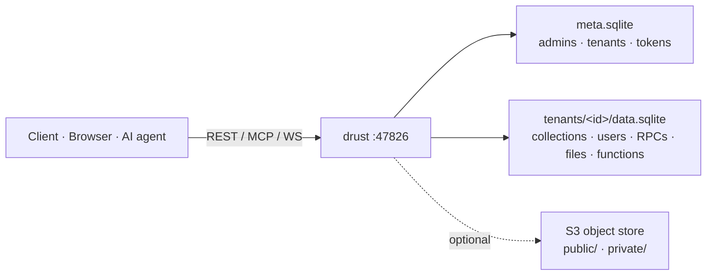

<div align="center">


<br/>

**AI agent 能直接驅動、使用者能信任的後端。**
自架、多租戶的 SQLite Backend-as-a-Service，單一 Rust 執行檔：每個租戶各有 REST
**與**原生 MCP 端點、row-level security、realtime、向量搜尋、WebAssembly edge functions。
一租戶一檔案，不用另外跑資料庫伺服器。

[](https://www.rust-lang.org)
[](https://modelcontextprotocol.io)
[](https://www.sqlite.org)
[](#zap-快速開始)
[](CHANGELOG.md)
[](LICENSE)

[**快速開始**](#zap-快速開始) · [**你能做什麼**](#rocket-你能做什麼) · [**為何選 drust**](#bulb-為何選-drust) · [**文件**](docs/architecture.md) · [English](README.md)

</div>

---

## :sparkles: 一句話

為每個小應用各起一套 Postgres / Supabase 太重了 —— 一個團隊會累積數百個小 app、內部工具、AI agent 暫存區。**drust** 給每個專案一顆自帶的 `tenant.sqlite`、一套寫入路徑絕不吃 raw SQL 的型別化 API、row-level security，以及一個 AI agent **零膠水程式**就能驅動的 per-tenant MCP 伺服器 —— 全部來自單一執行檔，idle 約 15 MB、約 13k req/s。

## :rocket: 你能做什麼

| | |
|---|---|
| :bricks: **SaaS / CRUD 後端** | 在後台定義 collection，立刻拿到 REST + 型別化 TypeScript/Zod client。不必跑 DB 伺服器、不必 migration 工具。 |
| :robot: **AI-agent 原生資料層** | 任何 MCP client 指向 `/t/<id>/mcp` —— agent 透過型別化工具檢視 schema、CRUD、向量搜尋、管理檔案。錯誤帶 `suggested_fix`、三個破壞性操作（`delete_record`、`drop_collection`、`drop_index`）支援 `dry_run`。 |
| :office: **多租戶平台** | 單一程序、多個完全隔離的租戶。跨租戶存取由 authorizer 在 **SQL 層**就擋掉，不只是應用層。 |
| :lock: **per-user 受保護資料** | 宣告 `owner_field`，或寫 PocketBase 風格的 row-level policy —— 每次 **record** 讀、寫、realtime 事件都自動過濾。上傳的檔案走同形狀的另一道閘：逐 verb cap 外加依檔案邏輯路徑前綴的 policy。 |
| :zap: **Realtime 應用** | 用 SSE 訂閱，或在單一 WebSocket 上多工多個 room 並廣播 JSON。 |
| :brain: **語意搜尋** | 加一個 `vector` 欄位，對結構化 filter 做 cosine / L2 / L1 top-k。 |
| :mag: **全文搜尋** | 對 TEXT 欄位建立 trigram（對中文友善、預設）或 `unicode61` FTS5 索引，再於任何 `/list` / `/search` / `/aggregate` filter 加上 `{"$fts":{"index":"…","query":"…"}}` —— 命中結果與其他讀取一樣受 owner / RLS 範圍限制。 |
| :hook: **事件驅動自動化** | 上傳一支小 WebAssembly edge function，在 record 變更或檔案上傳時 in-process 執行。 |

## :bulb: 為何選 drust

- **:robot: AI 原生，不是事後外掛。** 每個租戶都有一個 Streamable-HTTP MCP 伺服器，其 `instructions` 開場白是結構化的 *intent → tool* 地圖，讓 agent 連上第一次就能上手 —— 不需 prompt engineering、不需自製 tool wrapper。
- **:ice_cube: 單一 binary、一租戶一檔。** SQLite 內嵌，不必另跑或另備份資料庫伺服器。跨租戶 `ATTACH` 不可能 —— 由 SQLite authorizer 在唯讀連線上強制。
- **:closed_lock_with_key: 會疊加的安全。** `owner_field` + per-operation RLS policy（結構化 Filter AST → `?`-bound SQL）在每個 record 讀/寫/realtime 面 AND 疊加；檔案同樣兩道閘疊加——外層逐 verb cap、內層 per-prefix policy。寫入路徑**永不**吃 raw SQL。發佈到 public 桶的物件是刻意的例外：它由物件儲存直接送出，所以「可否公開」是 per-prefix 授權，而非每次請求的檢查。
- **:feather: 最快又最密。** idle 約 15 MB、筆電上約 13k req/s、256 MB 的機器塞數十個租戶。以 Rust 建構於 [axum](https://github.com/tokio-rs/axum) + [`rmcp`](https://github.com/modelcontextprotocol/rust-sdk)。
- **:battery: 電池全附。** Realtime（SSE + WS rooms）、向量搜尋、wasm edge functions、stored RPC、per-tenant OAuth、outbound webhooks（含 SSRF 防護）、S3 檔案儲存含可續傳上傳、型別化 client codegen（OpenAPI / TS / Zod）、Prometheus metrics、每日備份，以及 Supabase 風格後台。
- **:computer: gh 風 CLI。** `drust` 命令列工具以瀏覽器 **device flow** 登入（`drust auth login`，不貼 token），操作 host admin-plane（`drust admin tenants|keys|team|audit|backups`)與 per-tenant CRUD，全走同一套 HTTP 介面。每次 release 附 Linux（x86_64 / aarch64）、macOS（Apple Silicon）、Windows 預編 binary。

## :bar_chart: 對照

| | **drust** | PocketBase | Supabase | Firebase |
|---|:---:|:---:|:---:|:---:|
| **授權 / 開源** | AGPL-3.0 | MIT | Apache-2.0 | 專有 |
| 自架、單一 binary | :white_check_mark: | :white_check_mark: | :warning: 重型堆疊 | :x: 僅雲端 |
| Per-tenant DB 隔離 | :white_check_mark: 一租戶一 SQLite | :x: 單一 DB | :x: 單一 Postgres | :warning: |
| **給 AI agent 的原生 MCP 端點** | :white_check_mark: | :x: | :x: | :x: |
| Row-level security | :white_check_mark: owner + policy | :white_check_mark: rules | :white_check_mark: Postgres RLS | :white_check_mark: rules |
| Realtime | :white_check_mark: SSE + WS rooms | :white_check_mark: | :white_check_mark: | :white_check_mark: |
| Edge functions | :white_check_mark: wasm, in-process | :warning: JS hooks | :white_check_mark: Deno, 分離 | :white_check_mark: 分離 |
| 向量搜尋 | :white_check_mark: sqlite-vec | :x: | :white_check_mark: pgvector | :warning: |
| 型別化 client codegen | :white_check_mark: OpenAPI/TS/Zod | :warning: | :white_check_mark: | :warning: |
| Idle footprint | ~15 MB | 小 | 大 | n/a |
| 語言 | Rust | Go | TS / Elixir | 專有 |

## :zap: 快速開始

drust 只服務 plain HTTP —— 正式環境請在前面擺一個負責 TLS 終止的反向代理（Caddy、nginx、Traefik）。

**直接跑預編 image** —— 多架構（amd64 / arm64），免 clone、免建置：

```bash
docker run -d --name drust -p 47826:47826 -v drust-data:/data \
  -e DRUST_INIT_ADMIN_USERNAME=admin -e DRUST_INIT_ADMIN_PASSWORD=changeme \
  ghcr.io/kaellim/drust

curl -s http://localhost:47826/health   # → ok
open http://localhost:47826/login       # 後台 UI（root 模式）；用上面的 DRUST_INIT_ADMIN_* 登入
```

**或從 repo 建置** —— 多帶內附 Caddy 與選用的 S3 儲存：

```bash
git clone https://github.com/KaelLim/drust.git && cd drust

docker compose up -d                 # drust 跑在 http://localhost:47826（不含檔案儲存）
# ...或連同 S3 檔案儲存（drust + RustFS），只需一次：
deploy/compose-storage-env.sh        # 寫入 .env：COMPOSE_FILE 與新產生的金鑰
docker compose up -d
```

```bash
curl -s http://localhost:47826/health        # → ok
open http://localhost/login                  # 後台 UI（經內附 Caddy，root 模式）；用 DRUST_INIT_ADMIN_* 登入
```

> [!CAUTION]
> 不要在會擋 `mmap(PROT_EXEC)` 的 seccomp/AppArmor profile 下跑這個容器 —— wasmtime 的 JIT（edge functions 用）需要可執行記憶體。Docker 預設 profile 沒問題；guest 沙箱是在 wasmtime *內部* 落實，不是靠 process 級 W^X。

<details>
<summary><b>改從原始碼建置</b></summary>

```bash
git clone https://github.com/KaelLim/drust.git && cd drust
cp .env.example .env             # 編輯 DRUST_INIT_ADMIN_* 等
cargo build --release
./target/release/drust            # 預設綁 127.0.0.1:47826
curl -s http://127.0.0.1:47826/health   # → ok
```
systemd 搭反向代理的部署見 [`CLAUDE.md`](CLAUDE.md) 與 `deploy/` 的 unit 範本。

</details>

## :building_construction: 架構



三個請求介面 —— 後台 UI（cookie session）、租戶 REST（`anon` / `user` / `service` bearer）、租戶 MCP（僅 `service`）。Public 物件讀取完全繞過 drust；drust 只在*寫入*路徑。完整逐檔原始碼索引在 [`docs/architecture.md`](docs/architecture.md)。

<details>
<summary><b>API 介面</b></summary>

| 介面 | 路徑 | 認證 | 用途 |
|---|---|---|---|
| 後台 UI | `/admin/*` | Cookie session | 租戶 + schema 管理、policy、檔案、function |
| 租戶 REST | `/t/<id>/...` | Bearer（`anon` / `user` / `service`） | CRUD、`/list`、`/search`、RPC、檔案、上傳、realtime |
| 租戶 MCP | `/t/<id>/mcp` | Bearer（僅 `service`） | LLM 工具呼叫 —— CRUD、schema、index、RPC、檔案、向量搜尋、webhook、policy、function |
| Codegen | `/t/<id>/{openapi.json,types.ts,zod.ts}` | Bearer | 依租戶當前 schema 的型別化 client |
| Health | `/health` | 無 | Liveness probe |

</details>

<details>
<summary><b>設定（環境變數）</b></summary>

| 變數 | 必填 | 用途 |
|---|---|---|
| `DRUST_DATA_DIR` | 是 | `meta.sqlite`、`meta_logs.sqlite`、`tenants/`、備份的根目錄 |
| `DRUST_LOG_DIR` | 是 | 保留的 log 目錄 |
| `DRUST_INIT_ADMIN_USERNAME` | 首次開機 | bootstrap admin 帳號 |
| `DRUST_INIT_ADMIN_PASSWORD` | 首次開機 | bootstrap admin 密碼 |
| `DRUST_BIND` | 選用（`127.0.0.1:47826`） | 監聽位址 —— 容器內設 `0.0.0.0:47826` |
| `DRUST_PUBLIC_URL` | 選用 | 對外 base URL —— OAuth redirect/callback 連結需要 |
| `DRUST_CORS_ORIGINS` | 選用 | 逗號分隔允許清單；支援 `https://*.example.com`、`http://localhost:*` |
| `DRUST_TRUSTED_PROXIES` | 選用（2；映像檔 0；`docker-compose.yml` 1） | drust 前面會在 `X-Forwarded-For` 追加一項的反向代理層數；per-IP 限流以該項為 key（`0` = TCP 對端）。範圍 0–8。把映像檔放在自己的代理後面時要設定 |
| `DRUST_DISK_MIN_FREE_PCT` | 選用（20） | 低磁碟上傳守門——僅監看**資料庫**檔案系統，不含獨立的物件儲存 PVC |
| `GARAGE_S3_ENDPOINT` + `GARAGE_S3_ACCESS_KEY` + `GARAGE_S3_SECRET_KEY` | 選用 | 啟用檔案儲存，任何 S3 相容服務皆可（RustFS、Garage、MinIO、R2、AWS S3、B2）。`GARAGE_` 字首是歷史名稱；Compose 的儲存設定檔會替你設好 |
| `GARAGE_ADMIN_ENDPOINT` + `GARAGE_ADMIN_TOKEN` | 選用 | 僅 Garage：只有對帳頁清理舊版「每租戶 bucket」時使用。兩者都要設；只設一個會在啟動時警告並視為未設定 |
| `DRUST_PUBLIC_BASE_URL` | 選用（`http://localhost:8793`） | 檔案、簽署與 MCP 宣告 URL 對外使用的來源，不含路徑。Compose 設為 `http://localhost`；chart 由 ingress 主機推得 |

S3 資料路徑走 `object_store::aws::AmazonS3`（path-style、SigV4），任何 S3 相容服務都能用：RustFS（Compose 預設）、Garage（bare-metal 參考主機）、MinIO、R2、AWS S3、B2。

drust 不會建立 bucket。首次上傳前請先建好：
- `public`：匿名**只允許 GetObject**，切勿用同時開放列舉的「download」範本。
- `private`：不開放匿名存取。

任一個無法列出時，drust 會在啟動時記錄警告。公開檔案由反向代理直接自 `public` 提供、不經過 drust：請照抄 `deploy/compose.Caddyfile` 的 `/public/*` 區塊（sandbox CSP、nosniff、僅 GET/HEAD、捨棄 query）。Compose 的儲存設定檔與 Caddy 已替你做好這一切。

</details>

<details>
<summary><b>Docker Compose 的物件儲存</b></summary>

**啟用。** 在 repo 根目錄執行一次：

```bash
deploy/compose-storage-env.sh        # 寫入 .env：COMPOSE_FILE 與新產生的金鑰
docker compose up -d
```

這支腳本在 `docker-compose.yml` 旁寫入 `.env`（權限 600），內容是
`COMPOSE_FILE=docker-compose.yml:docker-compose.storage.yml`——之後每個一般的 `docker compose`
指令都會一併載入儲存設定檔——以及新產生的金鑰：RustFS 的 root 金鑰與 drust 自己的金鑰。它只補上缺少的項目，
絕不更改或印出既有的值；若 `.env` 已把 `GARAGE_S3_ENDPOINT` 指向其他儲存服務，它會拒絕執行。Windows
請手動寫入同樣五行，`COMPOSE_FILE` 改用 `;` 分隔。若你另有 `docker-compose.override.yml`，請自行把它加進
`COMPOSE_FILE`：一旦設定了 `COMPOSE_FILE`，Compose 就不會再自動載入 override 檔。

`docker-compose.storage.yml` 執行 RustFS 1.0.5（以 digest 鎖定），不對主機開放任何 port、關閉 web
主控台，另有一次性的 `rustfs-init`：建立 `public` 與 `private`、讓任何人都能 GET `public` 裡的物件且僅止於此
（不能列舉），並給 drust 一把只能使用這兩個 bucket 的專屬金鑰。drust 從不持有 RustFS 的 root 金鑰。

- **更換金鑰**：編輯 `.env`，再執行一次 `docker compose up -d`。`rustfs-init` 每次執行都會依 `.env`
  重新套用 drust 的金鑰；RustFS 在更換 root 金鑰後仍保留使用者與政策（於 1.0.5 觀察到）。更換 drust 的
  *access* key 會留下舊的 RustFS 使用者；如有需要，用 `rc admin user remove` 移除。
- **儲存服務 log**：`docker compose logs rustfs`。
- **主控台**：預設關閉。要使用時，在 override 檔裡替 `rustfs` 設 `RUSTFS_CONSOLE_ENABLE: "true"` 並開放
  `127.0.0.1:9001:9001`。

**改用 MinIO、Garage 或其他儲存服務。** 不要執行這支腳本。在 `docker-compose.override.yml` 裡替 `drust`
設定三個 `GARAGE_S3_*` 變數，依「設定」一節建好兩個 bucket，並用 `PUBLIC_OBJECTS_UPSTREAM`（`caddy`
服務的變數，預設 `rustfs:9000`）把 Caddy 的 `/public/*` 指向該儲存服務：

- Garage：把 `PUBLIC_OBJECTS_UPSTREAM` 設為它的 `s3_web` 端點（例如 `garage:3902`），並把
  `deploy/compose.Caddyfile` 裡標記 `STORE-SHAPE` 的兩行換成其註解中的 Garage 寫法。
- MinIO（path-style S3 API）：設定 `PUBLIC_OBJECTS_UPSTREAM` 即可；本版未經測試。
- R2 或 AWS S3：需要該服務自己的公開端點；把 `/public/*` 區塊整段搬過去，`@markup`、捨棄 query、
  方法限制與標頭移除都保持不變。

未啟用儲存時，`/public/*` 由 Caddy 回 502（上游名稱無法解析）；本來就沒有公開檔案可提供，其餘服務不受影響。

**從內附的 MinIO 升級。** 直到本版之前，`docker compose --profile storage up -d` 會執行內附的 MinIO。
這個服務與 `storage` profile 已移除，因為 `minio/minio` 映像檔已無法從 Docker Hub 取得。你的物件仍在
`minio-data` volume 裡；本 compose 檔不再宣告它，所以不會有任何東西刪除它。**升級後舊的 `minio` 容器會繼續
執行，port 9000/9001 開在所有介面上，並使用公開過的 `drustkey`/`drustsecret`；`docker compose up -d`
只會對它發出警告。** 請擇一處理：

- **保留 MinIO**（本版未經測試）。不要執行 `deploy/compose-storage-env.sh`。把下面的
  `docker-compose.override.yml` 放在 `docker-compose.yml` 旁，並在 `.env` 設定 `MINIO_ROOT_USER` /
  `MINIO_ROOT_PASSWORD`：

  ```yaml
  # docker-compose.override.yml — keep running your own MinIO.
  services:
    minio:
      image: <the MinIO image you already have locally>  # minio/minio is no longer on Docker Hub
      restart: unless-stopped
      command: server /data --console-address ":9001"
      ports:
        - "127.0.0.1:9001:9001"      # console, host-local; the S3 port needs no host binding
      environment:
        MINIO_ROOT_USER: ${MINIO_ROOT_USER:?set in .env}
        MINIO_ROOT_PASSWORD: ${MINIO_ROOT_PASSWORD:?set in .env}
      volumes:
        - minio-data:/data
    drust:
      environment:
        GARAGE_S3_ENDPOINT: http://minio:9000
        GARAGE_S3_ACCESS_KEY: ${MINIO_ROOT_USER:?set in .env}
        GARAGE_S3_SECRET_KEY: ${MINIO_ROOT_PASSWORD:?set in .env}
    caddy:
      environment:
        PUBLIC_OBJECTS_UPSTREAM: minio:9000
  volumes:
    minio-data:    # same name: the existing <project>_minio-data volume is reused
  ```

  它重新宣告 `minio`：主控台只開在 `127.0.0.1`、不開 S3 port，所以下一次 `docker compose up -d`
  會以無暴露的設定重建舊容器。接著：
  - 換掉 `drustkey` / `drustsecret`——它們已公開過，而且其 S3 port 曾開在所有介面上；
  - 把 `public` 上的 `download` 範本政策換成只允許 GetObject 的
    `deploy/compose-rustfs/public-read.json`（範本政策也允許列舉 bucket），例如在 compose 網路上用
    `amazon/aws-cli` 映像檔執行：
    `--endpoint-url http://minio:9000 s3api put-bucket-policy --bucket public --policy file:///p.json`；
  - 若 `public` 與 `private` 從未建立，請建立它們。
- **不再使用**：執行 `docker compose up -d --remove-orphans`（或
  `docker rm -f <project>-minio-1`）。容器連同開放的 port 與公開過的憑證一起移除；物件仍留在 `minio-data`。

**把物件從 MinIO 搬到 RustFS。** 尚未提供文件（未經測試）。在那之前請用上面的 override 保留 MinIO；
你的物件仍在 `minio-data` 裡。

</details>

> [!IMPORTANT]
> **備份快照僅含資料庫。** drust 的 `*.tar.zst` 快照（以及 k3s 的 DB VolumeSnapshot /
> Litestream）只涵蓋 SQLite 資料庫，不含上傳的物件。要成為可還原的災難復原單位，每份 DB
> 備份都須搭配物件儲存備份：bare-metal `garage-backup.timer`、k3s `objectMirror`
>（Litestream 只備份資料庫、不含物件）、docker-compose 則備份 `rustfs-data` volume（先停 `rustfs` 以取得一致的複本），或用 S3 工具把兩個 bucket 複製出來。快照亦含明文憑證——
> 切勿未加密存放於機外。含 **trigram** FTS 索引的租戶 DB 需主機 `sqlite3` ≥ 3.34 才能 `VACUUM`／還原
>（trigram tokenizer 的最低版本），內建引擎較新，但主機工具未必。

## :books: 深入了解

- [`CHANGELOG.md`](CHANGELOG.md) —— 完整版本歷史（keepachangelog、semver）
- [`docs/architecture.md`](docs/architecture.md) —— 自動產生的逐檔原始碼索引
- [`CLAUDE.md`](CLAUDE.md) —— 深入內部指南（架構、不變式、慣例）

## :page_facing_up: 授權

drust 採用 [GNU Affero General Public License v3.0](LICENSE)（AGPL-3.0-only）。

個人、內部、或非商業用途的自架完全在 AGPL-3.0 涵蓋範圍內。若你打算 (a) 將 drust —— 或其修改版 —— 作為託管服務提供給第三方，或 (b) 整合進無法以 AGPL 釋出原始碼的專有產品，則很可能需要另外的**商業授權**。洽詢請在 GitHub 開一個帶 `commercial-license` 標籤的 issue。
